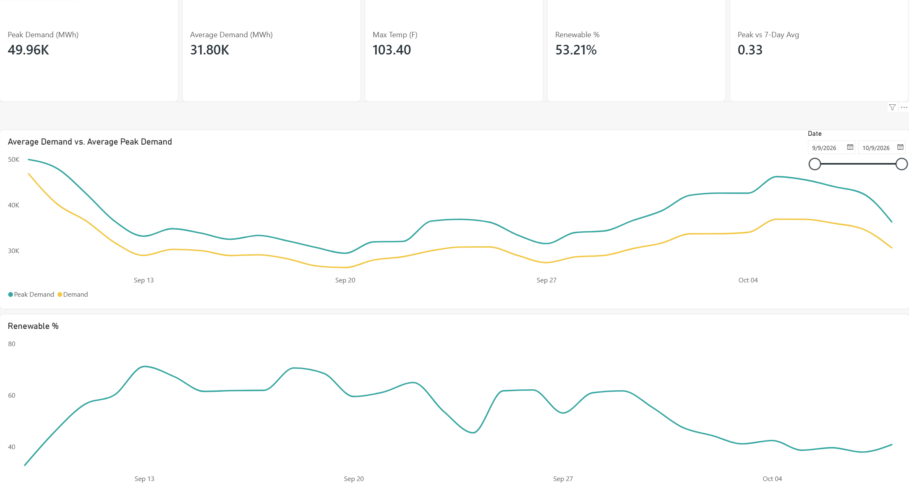
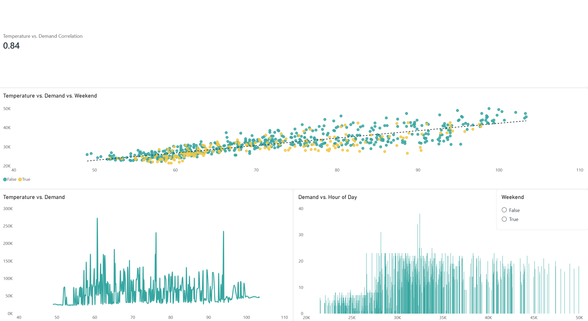
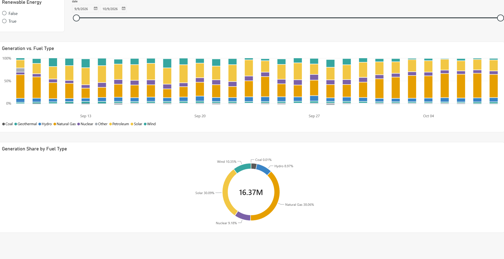

# Electric-Monitor

A grid reliability & demand intelligence pipeline for Northern California,
built to show end-to-end data engineering and analytics skills aimed at
the utilities industry: free public APIs -> DuckDB -> dbt -> Power BI,
with an AI agent layer (natural-language SQL and anomaly briefings) on top.

**Region**: CAISO (California Independent System Operator, EIA
respondent code `CISO`) — the balancing authority covering Northern and
Central California. Weather is sampled at Sacramento as a representative
Northern California point.

## Dashboard

Power BI report built on the Parquet marts (`powerbi/Electricity-Monitor.pbix`).
Build steps and DAX measures are in [`docs/powerbi.md`](docs/powerbi.md).

**Grid overview** — KPI cards, demand trend, and renewable share


**Demand vs. weather** — hourly temperature/demand relationship (correlation 0.84)


**Fuel mix** — daily generation share by fuel type


Live dbt docs and lineage: https://briandoce.github.io/Electric-Monitor/

## Key findings

From the complete days in the window (full write-up in [`docs/findings.md`](docs/findings.md), generated from the marts by `reports/generate_findings.py`; figures below are from the Oct 16 snapshot):

- Temperature drives load: daily peak demand vs. daily high **r = 0.85**,
  about **+564 MWh of peak demand per +1 F**.
- The **duck curve** is visible: demand minus solar climbs about **18.6 GW in
  8 hours** (11 am to 7 pm) as solar fades, and natural gas output roughly
  doubles to cover it.
- Renewable share moves against demand (**r = -0.80**): it fell from 65% to
  45% during an early-October heat spell, then recovered to 57% when it cooled.
- The anomaly agent flagged Oct 15 as ~18% lower than temperature predicts
  ([`docs/insights/`](docs/insights/)).

## AI agents

- **SQL agent**: `python agents/sql_agent.py "your question"` answers in plain
  English and shows the SQL it ran (read-only, SELECT-only).
- **Anomaly agent**: statistical detection plus a Claude-written analyst note,
  run daily in CI. Details in [`agents/README.md`](agents/README.md).

## Why this project

Utility analysts work with demand/load data, generation fuel mix, and
weather-driven load forecasting every day. This project pulls the same
category of data a CAISO or utility analyst would actually look at:

- Hourly electricity demand (MWh)
- Hourly generation by fuel type (solar, wind, hydro, gas, nuclear, etc.)
- Hourly temperature, to analyze the classic demand-vs-weather relationship
- Daily renewable-generation share, peak demand, and temperature extremes

See [`docs/architecture.md`](docs/architecture.md) for the full pipeline
diagram and design rationale.

## Stack

| Layer | Tool | Why |
|---|---|---|
| Ingestion | Python (`requests`, `pandas`) | Simple, testable, no framework overhead |
| Data sources | [EIA v2 API](https://www.eia.gov/opendata/) (free), [Open-Meteo](https://open-meteo.com/) (free, no key) | Real utility-grade data, zero cost |
| Warehouse | [DuckDB](https://duckdb.org/) | Free, file-based, works like a real analytical warehouse for dbt |
| Transform | [dbt-core](https://www.getdbt.com/) + dbt-duckdb | Tested, documented, versioned SQL models |
| Orchestration | GitHub Actions (free tier) | Daily scheduled runs, CI for data quality |
| BI | Power BI | Dashboards on top of exported Parquet marts |
| Docs | dbt docs -> GitHub Pages | Public, checkable data lineage artifact |
| AI agent | see [`agents/README.md`](agents/README.md) | NL-to-SQL agent and anomaly-summary agent (both built, Claude API) |

## Project layout

```
ingestion/        Python scripts: pull from EIA + Open-Meteo into DuckDB
warehouse/        electric_monitor.duckdb (generated, gitignored)
dbt/              dbt project: staging models, marts, tests, docs
data/marts/       Parquet exports of the dbt marts, for Power BI (generated)
docs/             Architecture notes, Power BI build guide, dashboard screenshots (docs/img)
powerbi/          Power BI report (.pbix)
agents/           AI agents: NL-to-SQL assistant and anomaly briefing
reports/          Generates docs/findings.md from the marts
.github/workflows/  Daily pipeline: ingest -> dbt run/test -> export -> docs
```

## Setup

1. **Get a free EIA API key**: https://www.eia.gov/opendata/register.php
2. Copy `.env.example` to `.env` and fill in `EIA_API_KEY`.
3. Install dependencies:
   ```
   pip install -r requirements.txt
   ```
4. Run ingestion:
   ```
   cd ingestion
   python run_all.py
   ```
5. Run dbt (builds staging + mart models, runs tests):
   ```
   cd dbt
   dbt run
   dbt test
   ```
6. Export marts to Parquet for Power BI:
   ```
   cd ingestion
   python export_marts.py
   ```
7. In Power BI Desktop: **Get Data > Parquet**, point at the files in
   `data/marts/`, or open `powerbi/Electricity-Monitor.pbix` and refresh.
   Follow [`docs/powerbi.md`](docs/powerbi.md) for the model and measures.

The GitHub Actions workflow (`.github/workflows/pipeline.yml`) runs this
same sequence daily and publishes the dbt docs site via GitHub Pages. To
enable it in your fork: add an `EIA_API_KEY` repository secret, and
enable GitHub Pages (Settings -> Pages -> Source: GitHub Actions).

## Data model

- `stg_eia_demand`, `stg_eia_fuel_mix`, `stg_weather` — cleaned, typed
  staging views.
- `mart_demand_weather_hourly` — hourly demand joined to temperature, with
  day-of-week/weekend flags, for load-forecasting-style analysis. Keyed on
  `period_hour_utc`; `period_hour` / `hour_of_day` are Pacific local time.
- `mart_fuel_mix_daily` — daily generation by fuel type with % share of
  total generation and a renewable/non-renewable flag.
- `mart_grid_daily_summary` — one row per day: peak/avg/min demand, max/avg
  temperature, renewable %. The primary table for dashboard KPIs. Includes
  `hours_reported` / `is_complete_day` so partial days at the edges of the
  rolling window can be filtered out.

Every staging and mart model has `not_null`/`unique` dbt tests, plus
singular tests in `dbt/tests/` (demand and temperature ranges, fuel shares
summing to 100, renewable % bounds, no gaps in the hourly series, and a
72-hour freshness check), so a bad API pull fails the pipeline instead of
silently reaching the dashboard.

**Time zones:** EIA and Open-Meteo are both ingested in UTC, joined on
`period_hour_utc`, and converted to Pacific for display. Keying on UTC
keeps the repeated hour at the fall daylight-saving change from breaking
joins or uniqueness tests; `is_complete_day` accounts for 23/24/25-hour days.

## Notes on scope

- Raw ingestion is a **full refresh of a rolling 30-day window**, not an
  incremental/append pipeline. This is a deliberate simplification for a
  portfolio-scale project; documented rather than hidden. The consequence is
  that findings describe one month of autumn data, not seasonal behavior.
- Temperature comes from a **single point (Sacramento)**, not a
  load-weighted average across California.
- The AI agents are thin layers over the tested dbt marts: statistics decide
  what is anomalous, and the model explains it. The anomaly agent runs in CI
  as a non-blocking step; its notes and `docs/findings.md` are attached to the
  build artifact and not committed back automatically.
- Possible next steps: incremental loads for longer history, a load-weighted
  weather average, and hourly fuel mix in the marts for a direct duck-curve
  view.
